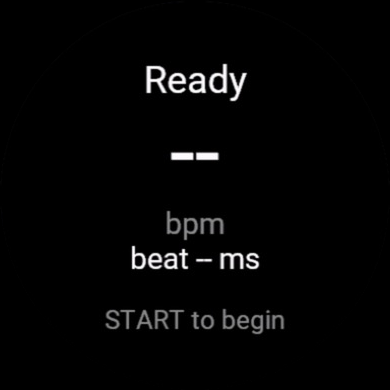
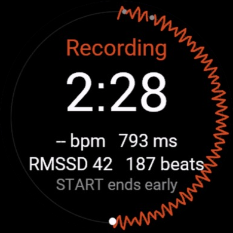
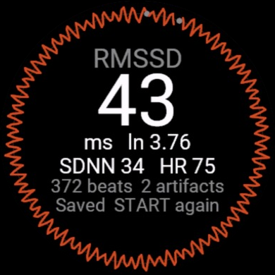

# Beat Log

An HRV test for the Venu 4 41mm that keeps every beat interval. The watch's
own tools (Health Snapshot, HRV Status) and the store apps tried so far only
save a final number; this saves the beats themselves in the activity's FIT
file, so RMSSD, SDNN or anything else can be worked out later.

| Ready | Recording, halfway | Results |
| --- | --- | --- |
|  |  |  |

*From the simulator's self-test, which feeds made-up beats with a fast
breathing rhythm through a full five-minute measurement. The two grey dots
near 12 o'clock are its deliberate artifacts.*

## Using it

1. Put the HRM600 on and sit down. Open Beat Log; the screen shows heart rate
   and the latest beat interval, so you can see beats are arriving.
2. Press START. One minute of "Sit still" settles your heart rate, then five
   minutes of recording. The watch vibrates at each change. START skips the
   settling, or ends the recording early. BACK (or swiping right) asks
   whether to discard the test.
3. The results screen shows RMSSD (and its natural log), SDNN, mean HR, how
   many beats and artifacts were counted, and in yellow how long the sensor
   missed beats and the wrist moved, if at all. The activity is already
   saved; START begins another test.

Keep the arm resting and still. The wrist sensor drops beats it can't place,
which is mostly when the wrist moves, and "Hold still" appears in yellow
while you're moving. A stretch of dropped beats is a gap: RMSSD doesn't
take a difference across it.

While it records, the beats are drawn around the edge of the screen: each
one at its moment in the five minutes, clockwise from 12 o'clock, further
out for a slower beat and further in for a faster one (against the settling
minute's average), so breathing shows up as waves. Artifacts are grey dots,
beats recorded while moving are yellow, and dropped beats leave a hole.
The ring closes when the timer runs out and stays on the results screen;
ending early leaves it open.

The screen's numbers drop beats outside 300–2000 ms or more than 20% away
from the previous good beat. The FIT file keeps every raw beat.

## What's in the FIT file

The activity is a normal one ("HRV", generic sport) with two laps: settling,
then the measurement. Beat Log adds developer fields:

| Message | Field | Meaning |
| --- | --- | --- |
| record | `rr` (16 × ms) | the newest 16 beat intervals, oldest first; unused slots 65535 |
| record | `rr_beat` | the number of the newest beat in `rr` |
| record | `gap_ms` | total time of the beats the sensor has dropped so far |
| record | `gap_beat` | the last beat before the latest gap |
| record | `motion` (mg) | the wrist's movement over the latest second: the accelerometer's spread |
| lap | `lap_rr`, `last_beat` | the same as `rr` and `rr_beat`, at the moment the lap closed |
| session | `rmssd`, `sdnn`, `mean_hr`, `beats`, `artifacts`, `gaps`, `gap_s`, `moving_s` | what the results screen showed |

The watch writes records on its own schedule, so the same beat can appear in
several records and the last second of a lap can miss them all. Numbering
the beats lets a reader place each one exactly once; the laps catch the
tail. Gaps are found by time: each once-a-second batch of beats should
account for the time since the previous one, give or take a beat, and the
watch records any larger shortfall. A gap shows in a file as a step in
`gap_ms`, after beat `gap_beat`.

## Reading a file

```
python3 -m venv .venv && .venv/bin/pip install -r tools/requirements.txt
.venv/bin/python -I tools/beats.py ACTIVITY.fit                # summary
.venv/bin/python -I tools/beats.py ACTIVITY.fit --csv out.csv  # every beat
```

It prints where heart rate came from (strap or wrist), the beat ranges for
each phase, any missing beats, and the measurement's statistics next to what
the watch said.

## Building and installing

```
scripts/build.sh               # bin/beatlog.prg
scripts/install.sh             # copy it to the watch over USB (quit Garmin Express first)
scripts/build.sh selftest      # simulator build that runs a test on made-up beats by itself
```

Activities land in the watch's `Garmin/Activity` folder; copy them off with
`mtp-getfile` as described in `~/src/watch-files`.
